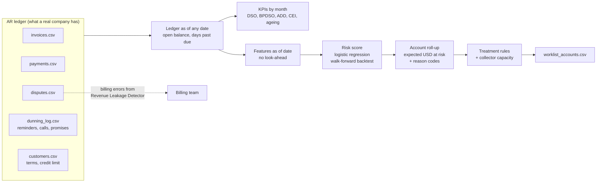

# Late Payments & Collections Prioritiser

**Deciding which overdue accounts get a collector's limited time, and what each of the others should get instead.**

This is part two of a contract-to-cash case study. The [Revenue Leakage Detector](../BA%20%20project) made sure the company **bills** what its contracts say. This project makes sure the cash **comes in**. It uses the same 300 customers and the same 11,856 invoices (USD 112.5M), and adds what happens after an invoice is sent: payments, part-payments, disputes and the collections team's activity.

It is less about building an engine and more about three business questions:

1. **Where are we?** DSO, collection effectiveness and ageing, and how they have moved.
2. **Who should we chase first?** A transparent late-payment risk score, tested on past months against today's "oldest invoice first" habit.
3. **What should each account get?** One treatment per account, set by risk, value and dispute status, and capped at what the team can actually handle.

---

## Results (as of 31 Oct 2026, synthetic data)

**Cash collection has deteriorated sharply in a year:**

| KPI | Oct 2025 | Oct 2026 |
| --- | ---: | ---: |
| Open AR | USD 5.72M | USD 6.93M |
| DSO | 36.3 days | **57.0 days** |
| Best possible DSO (if everyone paid on time) | 29.6 | 31.6 |
| Average days delinquent (the part collections can fix) | 6.7 | **25.4** |
| Collection effectiveness index | 82.5% | **50.4%** |
| AR more than 90 days overdue | 0% | **17.9% (USD 1.24M)** |

**Findings**

- **26 accounts that had stopped paying are still being invoiced.** Between them they owe USD 1.99M, which is 29% of all open AR. The median one is at **169% of its credit limit**, and one is at 465%. The current process has no credit-hold step, so billing keeps going after payment stops.
- **Billing errors from project 1 delay cash.** 564 invoices with a billing error were disputed, USD 5.9M in total. Most were rejected because the amount did not match the customer's purchase order. Disputed invoices were paid **35 days late on average, against 12 days for undisputed ones**, so every billing error held up its cash by about three weeks. Fixing billing accuracy is a cash-flow fix too.
- **Ranking by risk beats ranking by age.** In a walk-forward backtest over Jan–Sep 2026, the risk score separates invoices that will go seriously late from those that won't with AUC **0.88**. Days past due alone, which is what the current ageing report shows, scores 0.64.

| One collector, 40 accounts a week | Share of the money that really went seriously late that reached a collector |
| --- | ---: |
| As-is: oldest item first | 62% |
| Biggest overdue balance first | 66% |
| **Risk-based: expected USD at risk** | **71%** |

**Today's treatment plan (254 accounts with open AR):**

| Treatment | Accounts | Open AR | Expected USD at risk |
| --- | ---: | ---: | ---: |
| 1 Dispute desk: Billing fixes the invoice; dunning is paused | 28 | 607,855 | 166,691 |
| 2 Escalate: credit hold (+ agency review at 120+ days) | 26 | 1,991,113 | 1,941,349 |
| 3 Collector call, ranked, within capacity | 17 | 880,509 | 471,689 |
| 4 Pre-due check: confirm big invoices are approved for payment | 12 | 578,980 | 166,955 |
| 5 Firm automated reminder (high risk, low value, or 45+ days overdue) | 13 | 325,121 | 103,716 |
| 6 Standard reminder | 158 | 2,542,178 | 289,617 |

A collector spends time on 17 accounts. The 158 low-risk accounts, 62% of the list, never use a collector's time.

**Sanity check against the hidden answer key.** All 26 escalated accounts are customers the generator made "deteriorating". None of the prompt or steady payers was escalated or put on the call list.

### Cash-flow impact: 2026 replayed under the risk-based strategy

From January to September 2026, the worklist is rebuilt at every month-end using only what was known that day. The to-be treatments are applied, and the ledger and every KPI are recalculated. The effect of each treatment is an **assumption** (low / base / high), so the result is shown as a range:

| Impact (Jan–Oct 2026) | Low | **Base** | High |
| --- | ---: | ---: | ---: |
| Average DSO | −2.2 days | **−3.2 days** | −4.2 days |
| DSO on 31 Oct | −4.5 days | **−5.5 days** | −6.5 days |
| Working capital released (average AR funded) | USD 383K | **USD 514K** | USD 639K |
| Financing saving per year at 8% | USD 31K | **USD 41K** | USD 51K |
| Invoices not issued to accounts that never paid | USD 763K | **USD 763K** | USD 763K |
| Cash recovered from escalated accounts, net of fee | USD 60K | **USD 150K** | USD 239K |
| AR over 120 days on 31 Oct | −USD 185K | **−USD 284K** | −USD 384K |
| Cost: dispute desk (0.5 FTE) | USD 33K | USD 33K | USD 33K |

**What this means for the CFO:**

- **The credit hold is the lever that matters most, and it needs no assumption.** On its own it accounts for USD 217K of the USD 514K working capital released. It also stops USD 763K of invoices going to accounts that then never paid. 22 accounts were held. 96% of the invoice value sent to them after the hold was never paid; the other USD 35K, from one account, was good revenue a hold would have delayed. That is why a person reviews each hold instead of it switching on automatically.
- **Better call targeting helps, but less than expected.** Risk-ranked calls, pre-due checks and the dispute desk each lower average DSO by about half a day. Even in the high case, the sensitivity range on these levers moves the total by under USD 75K. The money is in **stopping exposure early**, not in chasing harder.
- **Fixing billing errors at source (project 1) is worth almost as much as the whole call strategy.** Removing the disputes that billing errors cause lowers average DSO by 2.0 days and releases USD 291K on its own. Together with the collections strategy, the totals are 4.7 days and USD 731K.

Details, lever breakdown, sensitivity and the month-by-month path: [cash impact report](output/cash_impact_report.md).

Full outputs: [collections summary](output/collections_summary.md) · [risk model backtest](output/risk_model_report.md) · [account worklist](output/worklist_accounts.csv) · [invoice worklist](output/worklist_invoices.csv)

## How it works



**The risk score.** For every open invoice at a month-end, it predicts whether the invoice will still be unpaid 30 days after the later of that month-end and the due date: in short, whether it is about to become a serious problem. The model uses 20 features that a credit controller would recognise:

| Strongest drivers (odds ratio per standard deviation) | |
| --- | ---: |
| Customer paying later than a year ago (trend) | 3.5× |
| Share of the customer's invoices paid 30+ days late | 2.3× |
| Item already 90+ days overdue | 2.3× |
| Usage of the credit limit | 1.6× |
| Share of the customer's balance that is overdue | 1.6× |
| Open dispute on the invoice | 1.5× |
| Broken promises to pay | 1.3× |

Each account on the worklist shows the top reasons in plain English, for example: *"paying 31 days later than a year ago; 48% of invoices paid 30+ days late; 5 broken promise(s) to pay"*. A collector can see why an account is on the list before picking up the phone.

## Key design decisions

- **No look-ahead.** Features use only payments, disputes and promises dated on or before the scoring date. The backtest walks forward month by month, and each month's model trains only on outcomes already known on that date. A test checks that removing future payments leaves the features unchanged.
- **The first model failed, and the fix is a finding.** Trained on 2024–25, when no customer had yet defaulted, a straight-line "days past due" term learned that *older* meant *about to be paid*. It then scored the 2026 defaulters as safe (decile 1: predicted 1%, actual 72%). Ageing now enters as buckets, and the model is retrained monthly. Any collections model needs the same monitoring, because payment behaviour shifts.
- **Prioritise accounts, not invoices.** Collectors call customers, so the score is rolled up into expected USD at risk per account.
- **Not every risky account belongs on the call list.** A customer 200 days overdue at 300% of their credit limit needs a credit hold and a decision from the Finance Manager, not a ninth reminder call. A disputed invoice needs Billing to fix it, and chasing it only annoys the customer. Taking these out first leaves collector time for accounts where a call changes the outcome.
- **Every threshold is in one place.** Capacity, risk cut-offs, the credit-hold age and the pre-due window are all in `src/config.py`, so the Credit Controller can change policy without touching code.

## How to run

Windows PowerShell, Python 3.10+:

```powershell
python -m venv .venv
.\.venv\Scripts\python.exe -m pip install -r requirements.txt

# (optional) regenerate the AR data from project 1's customers and invoices in data/source/
.\.venv\Scripts\python.exe generate_data.py --seed 7

# KPIs -> risk model backtest -> today's worklist -> cash-flow replay (about 25 seconds)
.\.venv\Scripts\python.exe -m src.run_pipeline

.\.venv\Scripts\python.exe -m pytest -q
```

## Dataset

`generate_data.py` takes project 1's customers, invoices and billing-error answer key (copied into `data/source/`) and simulates payment behaviour.

| | |
| --- | --- |
| Accounts | 300 contract customers + 391 one-off accounts (project 1's "no contract" invoices) |
| Invoices | 11,856, Jan 2024 – Oct 2026, USD 112.5M gross |
| Payments | 11,686, including part-payments |
| Disputes | 817, of which 628 come from billing errors in project 1 |
| Dunning actions | 14,607 reminders, calls and promises to pay under the current age-based policy |

Every customer has a hidden payment persona: prompt, steady-late, slow, admin-chaos or deteriorating (some of which default). These are stored in `data/truth_customer_behaviour.csv` and used **only** to sanity-check the output, never by the analysis.

## Project structure

```
src/
  config.py        snapshot date, model horizon, every collections-policy threshold
  ledger.py        AR ledger as of any date: open balance, days past due, open disputes
  kpis.py          DSO, best-possible DSO, ADD, CEI, % 90+, dispute impact
  features.py      risk features as of a date (no look-ahead) + reason-code wording
  risk_model.py    logistic regression, walk-forward backtest, capacity comparison
  worklist.py      scoring today, account roll-up, treatment rules, call weeks
  cash_impact.py   month-by-month replay of 2026 under the to-be strategy, scenarios, sensitivity
  run_pipeline.py  entry point: python -m src.run_pipeline
tests/             ledger maths, no-look-ahead, target, treatment rules, replay rules
output/            summary, backtest report, worklists, monthly KPIs, cash impact report
```

## Roadmap

- [x] AR ledger with payments, disputes and dunning history, linked to project 1's billing errors
- [x] Collections KPIs and ageing, month by month
- [x] Late-payment risk score with walk-forward backtest against the current oldest-first rule
- [x] Prioritised account worklist with treatments, reasons and collector capacity
- [x] Cash-flow impact: 2026 replayed under the to-be strategy, lever breakdown, low/base/high and one-at-a-time sensitivity, billing-fix what-if
- [ ] 13-week cash-collection forecast from predicted payment dates
- [ ] Requirements doc (stakeholders, collections policy, KPIs, user stories) and as-is / to-be dunning process map
- [ ] Power BI dashboard
- [ ] Case study write-up

## Limitations

- The data is synthetic, and the behaviour personas are cleaner than real customers. Real-data AUC would be lower.
- The backtest measures **who to call**, not **what the call achieves**. How much a call, a pre-due check or the dispute desk speeds up payment is an assumption (`config.SCENARIOS`) until it is tested, ideally with a holdout group: call half the list for a quarter and compare.
- The replay is conservative in two ways. Invoices still open on 31 Oct have no actual pay date to improve on, and treatments act at month-end, not weekly.
- "Invoices not issued" is bad debt avoided, not new cash. The cash saving is the cost of serving those accounts.
- 391 one-off accounts each have a single invoice and no payment history. The model handles them with a "no history" flag.
